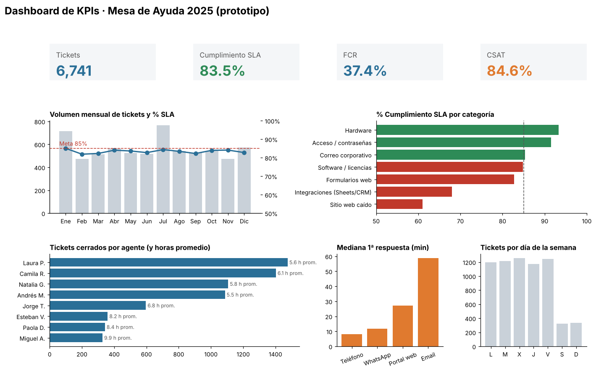

# 📊 Dashboard de KPIs de Mesa de Ayuda · Power BI

> **EN:** Star-schema data model and DAX measures for a Helpdesk KPI dashboard (SLA, FCR, CSAT, response time), with a Python prototype used to validate every metric before building it in Power BI.

## Problema de negocio
El área de soporte necesita saber **si está cumpliendo sus acuerdos de servicio (SLA)**, qué categorías de incidentes generan incumplimientos y cómo se distribuye la carga entre agentes y canales.

## Herramientas
`Power BI` · `DAX` · `Power Query` · `Modelado dimensional (estrella)` · `Python` · `pandas`

## Modelo estrella
```
                 dim_fecha
                     │
 dim_agente ── fact_tickets ── dim_categoria
                     │
                 dim_canal
```
- `fact_tickets`: 6.741 tickets de 2025 (tiempos, SLA, escalamiento, FCR, CSAT)
- 4 dimensiones con llaves sustitutas, calendario completo y SLA por categoría
- Archivos en [`data/modelo_estrella/`](data/modelo_estrella/)

## KPIs (medidas DAX en [`powerbi/medidas_dax.dax`](powerbi/medidas_dax.dax))
| KPI | Valor 2025 |
|---|---|
| Tickets | 6.741 |
| % Cumplimiento SLA | **83,5%** (meta 85%) |
| Tiempo medio de resolución | 6,3 h |
| Mediana primera respuesta | 24,4 min |
| Resolución en primer contacto (FCR) | 37,4% |
| % Escalados a N2 | 15,3% |
| CSAT (calificaciones 4–5) | 84,6% |

Incluye inteligencia de tiempo (`DATEADD`, `TOTALYTD`), variación mes a mes y formato condicional por meta.

## Prototipo del dashboard


## Hallazgos
- **Sitio web caído (61%)** e **Integraciones Sheets/CRM (68%)** son las categorías más lejos de la meta de SLA → priorizar monitoreo y documentación de esas integraciones.
- **Email** es el canal más lento en primera respuesta (~59 min) frente a WhatsApp (~12 min) y Teléfono (~8 min).
- Los agentes N2 resuelven menos tickets pero más complejos (8–10 h promedio) → revisar la regla de escalamiento.

## Cómo reproducirlo
```bash
pip install -r requirements.txt
python src/construir_modelo.py     # genera el modelo estrella, KPIs de referencia y prototipo
```
Luego sigue la [guía de construcción en Power BI](powerbi/GUIA_CONSTRUCCION.md).

> ℹ️ Datos **sintéticos** inspirados en mi experiencia dando soporte de primer y segundo nivel.

---
**Juan Camilo Castro López** · Analista de Datos Jr · [LinkedIn](https://www.linkedin.com/in/juancastrolopez/)
